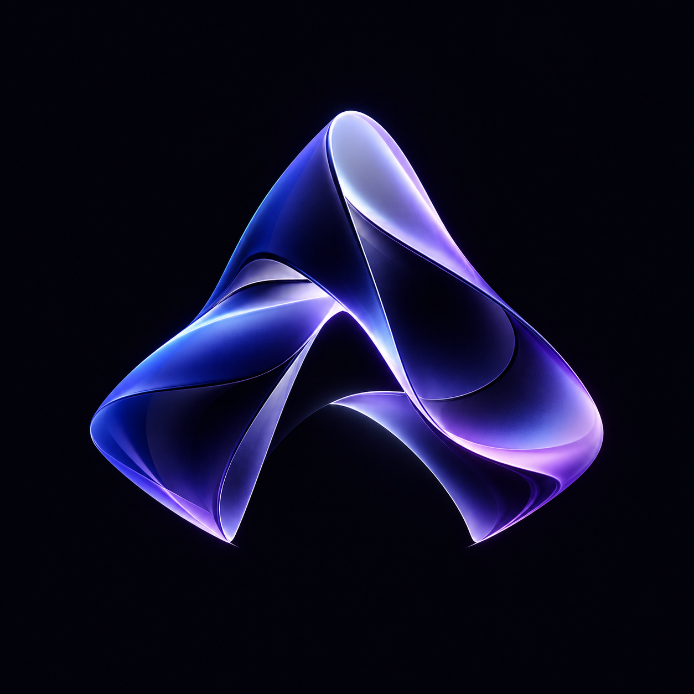

# Project Aetherwake

**Aerynth** is an actively developed intelligent spatial desktop environment for working with AI; **Vela** is its persistent, context-aware assistant. The accepted product vision is larger than what the current implementation has verified.

The goal is not to wrap Codex in a prettier chat window. Aerynth should combine first-class Codex conversations with spatial workspaces, project knowledge, notes, specialist agents, orchestration, universal contextual commands, observability, and adaptive context efficiency.

The [official Aerynth mark](assets/brand/aerynth-mark-master.png) is committed and verified, with its design identity and usage guidance documented in [Aerynth Brand Identity](docs/design/AERYNTH-BRAND-IDENTITY.md). Future application integration and alternate icon/animation variants are still pending.

**Visual experience is a product requirement:** the *Liquid Intelligence* design language calls for cinematic fluid motion, layered glass materials, meaningful particles, precise micro-interactions, and adaptive graphics that remain responsive under system load.

## Foundational principles

1. **The user expresses intent; Aerynth handles the complexity.**
2. **Intelligence is visible when useful, invisible when unnecessary, and accessible everywhere.**
3. **Aerynth never makes the user work harder to use its intelligence.**
4. **Chats remain first-class.** Casual conversation should never require formal tasks or orchestration.
5. **Show real activity, not fabricated thoughts or progress.** Distinguish observed events, agent-reported summaries, inferences, and unavailable internal reasoning.
6. **Retain full history while optimizing active context.** Memory trimming must not silently destroy original evidence.
7. **Prioritize beautiful, meaningful motion without wasting CPU, GPU, memory, or tokens.**
8. **Separate AI reasoning, the application data model, orchestration, and rendering.**
9. **Make consequential actions inspectable, permissioned, and reversible where possible.**
10. **Design the UI and motion architecture first, with an early real Codex connection.**

## Owner-accepted product baseline

The repository owner accepted Constitution 00 and governing Charters 01–16 on 2026-11-05, together with the capability-first API architecture, Spatial Intelligence/Stream V2 requirements and unified memory architecture. The governance registry also records the binding Fluid Intelligence amendments of 2026-11-10. This is binding design direction rather than a collection of suggestions. Implementation and independent test qualification remain separate.

Key accepted architecture: [Unified Memory Runtime](docs/architecture/VELA-UNIFIED-MEMORY-AND-CONTEXT-RUNTIME.md), [Vela Capability Execution Fabric](docs/architecture/VELA-CAPABILITY-RUNTIME-AND-EXECUTION-FABRIC.md), [Unified Spatial Runtime](docs/architecture/UNIFIED-SPATIAL-INTELLIGENCE-RUNTIME-AND-NAVIGATION.md), [Volumetric GPU Rendering Contract](docs/architecture/VELA-PRESENCE-GPU-RENDERING-CONTRACT.md), and [Stream V2 Experience](docs/specifications/INTELLIGENCE-STREAM-V2-EXPERIENCE-AND-ACCEPTANCE.md). The [governance registry](governance/README.md) is authoritative for status and ownership.

## Governance

The governing foundation lives in [`governance/`](governance/README.md), beginning with **[the Aetherwake Master Constitution](governance/00-AETHERWAKE-CONSTITUTION.md)**. It establishes the project's binding principles, the Liquid Intelligence experience, user-control requirements, agent and context integrity, observability, and the reserved specialized charters. **Publication and acceptance are separate statuses.** Consult the [live governance registry](governance/README.md) for which numbered charters exist, which are pending, and which have been accepted. Missing charters are authored separately; do not create placeholders for them.

## Start here

- [Documentation index](docs/README.md): setup, current source checkpoints, governance, acceptance evidence and historical reports.
- [Windows application guide](prototypes/visual-experience/cinematic-v3/APPLICATION.md): prerequisites, launch, private profiles, recovery and offline native verification.
- [Fluid Intelligence roadmap](plans/milestones/FLUID-INTELLIGENCE-REALIZATION.md): intended sequencing and gates, not a completion ledger.

## Engineering checkpoint (2026-11-12)

This summary describes main at [`c470a5d`](https://github.com/Kgray44/Aetherwake/commit/c470a5d23786ea2d5022553a1472e3643a619bb1). Recheck later changes before treating it as current.

**Architecture Recovery, Program A:** the A3/A4 work was integrated with FI-0–FI-3 in [PR #53](https://github.com/Kgray44/Aetherwake/pull/53). Consult the [A4 handoff](docs/engineering/A4-ARCHITECTURE-RECOVERY-HANDOFF.md) and [pinned integration report](docs/engineering/MISSION-01-04-INTEGRATION.md) for source ownership and verification boundaries. Historical A0/A1 and A2 reports remain evidence for their named checkpoints.

**Full Aerynth Realization, Program B:** [PR #59](https://github.com/Kgray44/Aetherwake/pull/59) added scoped acceptance evidence and the [FI acceptance registry](docs/engineering/FI-ACCEPTANCE-REGISTRY.json). [PR #60](https://github.com/Kgray44/Aetherwake/pull/60) added scoped FI-2 illustration and reviewed mission-planning qualification. The merge records owner acceptance of that scoped FI-2 work, not the entire product. The original strict retrieval result remains 7/8; broader independent cross-source retrieval and model-comparison claims remain unproven. [PR #61](https://github.com/Kgray44/Aetherwake/pull/61) is a separate draft follow-up at this checkpoint, not part of this main snapshot.

**Still separate:** native and provider qualification, independent quality/performance evidence, full spatial experience, and owner product/visual/release acceptance. A merged implementation, registered scenario or green fixture suite does not close these gates. Recovery cleanup remains distinct from permission to implement future product capabilities.

**Existing implementation:** the connected Electron desktop and cinematic application live primarily under `prototypes/visual-experience/cinematic-v3/`, with `prototypes/integrated-backend/`, `prototypes/vela-core/` and other source-owned domain modules. The `prototypes/` naming is historical; neither source location nor merged PR proves complete product acceptance. Keep synthetic experience previews separate from real native provider/tool execution and evidence.

See the [Architecture Recovery A0/A1 report](docs/engineering/A0-A1-RECOVERY.md) for the connected runtime, current verification status, and CI coverage. The [A2.1 transaction report](docs/engineering/A2-1-TRANSACTION-COORDINATION.md) covers the persistence implementation, measurements and verification. The [application guide](prototypes/visual-experience/cinematic-v3/APPLICATION.md) covers Windows setup and the offline native verification runner.

**Architecture references:** [ADR-002](docs/decisions/ADR-002-ARCHITECTURE-RECOVERY-AND-COHESIVE-RUNTIME.md), [Local-First Storage and Continuity](docs/architecture/AERYNTH-LOCAL-FIRST-STORAGE-AND-CONTINUITY.md), [CIE Semantic Interpretation and Evidence Retrieval](docs/specifications/CIE-SEMANTIC-INTERPRETATION-AND-EVIDENCE-RETRIEVAL.md), and [UMCR-01](docs/architecture/VELA-UNIFIED-MEMORY-AND-CONTEXT-RUNTIME.md).

**Rule:** real source evidence, owner permissions and task outcomes outrank visual simulation, model confidence and code volume.

## Repository map

| Location | Role |
|---|---|
| [`AGENTS.md`](AGENTS.md) | Agent instructions, charter routing, and collaboration safeguards |
| [`governance/`](governance/README.md) | Binding constitution, domain charters, and publication/acceptance registry |
| `docs/vision/` | Intended experience and product narrative |
| [`assets/brand/`](assets/brand/README.md) | Approved product visual assets and derivative inventory |
| `docs/architecture/` | System design and technical architecture |
| `docs/design/` | Interaction, materials, motion, and visual explorations |
| `docs/research/` | Benchmarks, research, and alternatives |
| `docs/specifications/` | Implementation-level contracts and details |
| `docs/decisions/` | Architecture and design decisions |
| `plans/milestones/` | Milestones, delivery phases, and goals |
| `plans/tasks/` | Actionable scoped work |
| `prototypes/visual-experience/cinematic-v3/` | Current connected Electron desktop and cinematic application, including synthetic previews |
| `prototypes/integrated-backend/` | Current backend integration and native/runtime orchestration |
| `prototypes/vela-core/` | Vela context, history and core assistant contracts |
| `prototypes/personal-context/` | Currently isolated, protected personal context service; full native CIE integration remains incomplete |

Git cannot track empty directories, so currently empty locations are reserved using `.gitkeep` placeholders. They are not substantive specifications or completed implementations.

Use the [documentation index](docs/README.md) to distinguish governing requirements, current source checkpoints and historical evidence.

> This repository is currently **public**. Do not commit credentials, private conversation history, personal notes, private project files, API keys, or real agent telemetry containing sensitive data.
