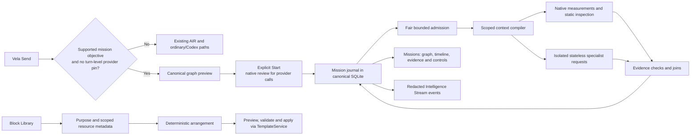

# Vela mission execution

This records the integrated mission slice. The [traceability matrix](../engineering/VELA-MISSION-TRACEABILITY.md)
tracks work and acceptance beyond this slice. The [AIR specification](../specifications/VELA-ADAPTIVE-INTELLIGENCE-ROUTING.md)
continues to govern the ordinary routing design; this change does not ratify it.

The deterministic planner recognizes explicit host sampling and Aerynth backend
performance objectives. It does not claim to interpret an arbitrary objective
or grant arbitrary shell, network or write capabilities. Performance work
uses a real worker timer, host counters and a bounded scan of the shipped Core
module. An observed timer outlier adds one follow-up measurement before the
report without changing the original acceptance criteria. Counts of source
call sites do not establish a measured bottleneck.

Mission rows are independent of conversation history and remain in the same
database as projects, resources and layouts. Additive startup creates the
mission tables and preserves existing schema versions. Mission and attempt IDs
correlate the journal and events; a review fingerprint binds the proposed graph,
workspace, provider controls and applicable profile versions. Mission access
requires the current canonical workspace scope. The scheduler separately
checks whether a queued or in-flight task still has authority.

Before dispatch, the journal records an attempt and a context manifest with
scope, dependency evidence digests and estimated context size. The compiler
keeps required inputs, rereads selected sources on validation and does not
store note bodies in the mission. The local Notes adapter is used only on the
explicit workspace-notes route. Existing conversation and Codex sessions
continue to own their respective histories.

Admission rotates between missions; within a mission it favors older work and
uses priority to order tasks within an age band. It enforces worker and provider
limits, the mission's parallelism setting, exclusive resource claims and a
physical-memory floor. A dependency join waits for verified prerequisites
and retains each contributing identity. Pause stops new admissions. A timeout
or cancellation does not release a claim until the worker settles. On restart,
in-flight external attempts become uncertain and are not replayed; interrupted
read-only work requires a deliberate retry, and queued missions reopen paused.

Specialists use the existing stateless Responses transport and credential
broker. The native review lists exactly which objective and instructions each
request sends. Live catalog identity, current connection and shared daily
limits are rechecked at dispatch. A selected Agent Library profile can supply
the first role's settings and instructions; edits invalidate the preview.
Specialists have separate attempt and response identities. They return
attributed recommendations; verification of the report contract is distinct
from verifying the recommendations. The reviewed specialist route does not
transfer files, note content, measurement values or conversation history.

The journal distinguishes native measurements, provider-reported usage and
unknown usage. Mission metrics use recorded transitions and do not convert
tokens into money. The native benchmark measures the same workload with one
and two workers. It does not estimate cloud model or renderer performance.

The Workspace Architect builds a purpose-specific draft from allowed block
kinds and scoped resource metadata. It reuses canonical IDs, chooses dimensions
from block constraints, and applies through the existing versioned template
transaction. Placement changes retain existing layout history. Desktop
template operations and mission execution both use the canonical services;
the template planner does not create a second workspace store.
