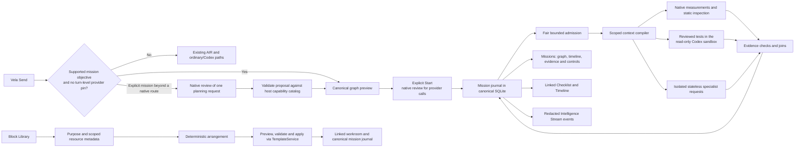

# Vela mission execution

This records the integrated mission slice. The [traceability matrix](../engineering/VELA-MISSION-TRACEABILITY.md)
tracks work and acceptance beyond this slice. The [AIR specification](../specifications/VELA-ADAPTIVE-INTELLIGENCE-ROUTING.md)
continues to govern the ordinary routing design; this change does not ratify it.

The deterministic planner recognizes explicit host sampling and Aerynth backend
performance objectives. Performance work
uses a real worker timer, host counters and a bounded scan of the shipped Core
module. An observed timer outlier adds one follow-up measurement before the
report without changing the original acceptance criteria. Counts of source
call sites do not establish a measured bottleneck.

An explicit mission request outside the deterministic routes can request a graph
proposal from the connected ChatGPT plan model. The native approval displays the
objective, selected model and available capability descriptions. The single
request sends the objective and public capability descriptions. Its response can
select catalog tasks and dependency edges. The host supplies executable task
definitions, resource claims, limits, verification criteria and the evidence join.
The compiler rejects malformed graphs and proposals that report unsupported
outcomes. The graph preview lets the user check whether the interpretation
covers the original objective. Start requires the reviewed fingerprint and
current workspace, plus any specialist or checkout approvals. Hosted specialists
can run as independent branches. Their approvals cover objective text and role
instructions, so the host rejects proposals with prerequisites on hosted
specialist tasks. The planner can configure up to two temporary specialists
with a single-line title and responsibility. The host controls provider,
model, tools and execution budget. The role exists only in its mission.
A confirmed planning receipt contributes to mission
duration and reported usage. Admitted planning requests are fenced against
replay after interruption or restart.

The selected-tests route asks for a native file selection and displays the
exact checkout, commit and argument vector. It uses the existing Codex App
Server local command runner with zero model inference. It requests restricted
network access. Effective isolation depends on the installed sandbox mode.
The worker rechecks the selected tracked files, checkout identity and sandbox
availability at dispatch and validates the TAP result after execution. The
profile records zero model calls for this lane.

Mission rows are independent of conversation history and remain in the same
database as projects, resources and layouts. Additive startup creates the
mission tables and preserves existing schema versions. Mission and attempt IDs
correlate the journal and events; a review fingerprint binds the proposed graph,
workspace, provider controls and applicable profile versions. Mission access
requires the current canonical workspace scope. The scheduler separately
checks whether a queued or in-flight task still has authority.

The Intelligence Stream carries typed lifecycle records with the originating
workspace, mission, task and attempt identities. Workspace visibility is
checked for live delivery and replay. The journal transaction stages pending
publication by mission ID and sequence. Each retained Stream row commits with
its queue acknowledgement. The journal occurrence time remains separate from
the Stream receipt time. Recovery stages its own observed events and resumes
pending publication at startup. Older retained entries recover scope from
matching journal records, subject to the existing retention window.

After its lifecycle records are published, a verified mission can answer in
its originating Vela chat. The message, report link, Stream receipt and report
queue acknowledgement commit together. Publication rechecks the origin and
current evidence. A failed or inaccessible report can wait independently of
other missions. The scoped answer links to the same evidence and stays outside
provider history. The queue stores only journal coordinates. Storage holds
defer publication, and transient failures retry with a bounded delay.

Before dispatch, the journal records an attempt and a context manifest with
scope, dependency evidence digests and estimated context size. The compiler
keeps required inputs, rereads selected sources on validation and does not
store note bodies in the mission. The local Notes adapter is used only on the
explicit workspace-notes route and reads the mission's originating workspace
even if the user navigates elsewhere. A bounded cache reuses ranking scores
after fresh authorized reads. Budget compaction defers whole optional sources
and retains a limited set of versioned pointers for revalidation. Mandatory
constraints and verified dependency outputs remain intact. Dispatch, result
acceptance and downstream evidence reuse check current source proofs. Stale
proofs hide the affected evidence and mark current verification as blocked.
An explicit retry may re-run an affected replay-safe task within its attempt
budget. Existing conversation and Codex sessions continue to own their
respective histories.

Admission rotates between missions. Ready tasks waiting 30 seconds receive
oldest-first service. For newer work, user priority precedes the length of the
remaining feasible dependency path. Admission also enforces provider and worker
limits, per-mission parallelism and exclusive resource claims.

The existing native storage guard and a 512 MiB available-memory floor can
hold new admissions. Running attempts retain their claims and can settle.
Two consecutive high CPU, busiest GPU engine or busiest physical disk queue
samples can reduce the shared limit to one worker. Lower release thresholds
reduce oscillation. Recent foreground Aerynth input can reinforce a measured
CPU or GPU load signal. The desktop sends only a coarse input observation.
Windows GPU and disk sampling starts after sustained queue demand, uses a
fixed local CIM query, and has a 20-second cooldown. The policy exposes the
latest available readings while work is pending. The journal records the
actual decision and available samples when each attempt starts. Missing or
expired readings appear as unavailable in the mission and Performance card.

A dependency join waits for verified prerequisites
and retains each contributing identity. Pause stops new admissions. A timeout
or cancellation does not release a claim until the worker settles. On restart,
in-flight external attempts become uncertain and are not replayed; interrupted
read-only work requires a deliberate retry, and queued missions reopen paused.
Evidence-triggered amendments record the triggering task and attempt and can
only repeat a replay-safe executor within the already reviewed claims. The
report waits for the added sample and the original criteria stay intact.

Specialists use the existing stateless Responses transport and credential
broker. The native review lists exactly which objective and instructions each
request sends. Live catalog identity, current connection and shared daily
limits are rechecked at dispatch. A selected Agent Library profile can supply
the first role's settings and instructions; edits invalidate the preview.
Specialists have separate attempt and response identities. They return
attributed recommendations; verification of the report contract is distinct
from verifying the recommendations. The reviewed specialist route does not
transfer files, note content, measurement values or conversation history.
An explicit research mission permits only the source specialist to use the
existing hosted web search. That role must return provider-attributed HTTPS
citations; its partner receives no tools. Citation presence is distinct from
independent factual confirmation.

Saved teams combine two to four existing Agent Library profiles with reviewed
responsibilities. The roster is reusable across authorized workspaces in a
project, or inside its originating standalone workspace. Versioned saves and
archives fence stale writes. Starting a team mission binds the roster version
and each profile version to separate hosted tasks. A local join waits for all
verified report contracts, retains the member task, attempt and evidence IDs,
and indexes repeated observations by normalized text. Claims and contradictions
remain attributable to the individual reports. The user can post one durable
evidence link for a verified mission to the originating Vela chat. The link
is visible only from the originating workspace and stays outside model history.
Evidence remains in the mission journal.

The journal distinguishes native measurements, provider-reported usage and
unknown usage. Mission metrics use recorded transitions and do not convert
tokens into money. Attempt details separate queue time, context preparation,
executor duration and verification time. Interrupted attempts can lack final
spans. The native benchmark measures the same workload with one
and two workers. An opt-in concurrent run samples backend process CPU, RSS
and event-loop delay, and compares admission with and without injected
pressure. Neither run measures cloud model or renderer performance.

The Workspace Architect builds a purpose-specific draft from allowed block
kinds and scoped resource metadata. It reuses canonical IDs, chooses dimensions
from block constraints, and applies through the existing versioned template
transaction. Placement changes retain existing layout history. Desktop
template operations and mission execution both use the canonical services;
the template planner does not create a second workspace store.
From an active or settled mission, the user can review a workroom's proposed
cards and create the workspace and its reusable template. Timeline creation,
template apply and the mission-to-workroom link share one transaction. The
graph, checklist, timeline, verification and performance cards project the
mission journal. A mission with specialists also receives a team card with
the assigned roles and recorded task states. The Intelligence Stream card
reads up to 128 recent retained events by mission identity from the existing
Intelligence Stream store. Its cursor and event IDs are the same as those in
the originating workspace's stream. An authorized linked workroom receives
the redacted lifecycle notification so its cards refresh while the mission
runs. General stream replay uses its own workspace scope. The workroom also
has a canonical local conversation and supporting resources selected by the
architect. The initial camera leaves the graph and conversation below the
workspace toolbar.

New workrooms retain the exact canonical local conversation binding. When the
mission verifies, a separate durable outbox delivers one attributed historical
handoff containing the objective, concise result, original evidence identities
and observation times. Creating a workroom after verification stages the same
delivery. Message, receipt binding, Stream event and outbox acknowledgement
commit together; a failure rolls them all back. Vela's compact originating
reply uses its own queue, so a handoff failure cannot suppress that answer.

The handoff remains a distinct application-authored receipt. It does not copy
Vela's global transcript or rebind a provider session. Existing conversation
branch controls select and review source context before a later provider send.
Inherited branches retain the original message identity. Every receipt read,
search, prepared review and future send rechecks the origin and workroom,
exact local chat placement, project identity and current evidence digest.
Unavailable or superseded evidence cannot enter future branch context. The
canonical historical receipt remains stored. Older workrooms without an exact
conversation binding retain their existing chat and receive no inferred link.

New specialist workrooms also retain one note-view binding per specialist task.
These are individual assignment projections of the canonical mission, not new
agent profiles or provider sessions. A queued assignment does not imply that
execution started. Attempt disclosures show recorded identities, times, context
receipts, reported usage and sanitized findings. Report-contract verification
remains separate from confirming a recommendation. The source-profile link
opens the existing resource, while the displayed profile versions describe the
recorded assignment. Retired tasks retain their own view and history; a view
does not silently redirect to a replacement. Source revocation withdraws its
evidence through the same mission projection. A changed plan invalidates a
pending workroom preview before creation. Earlier workrooms without these
bindings retain their existing layout.

The backend verifies access to both workspaces and to the exact card
placement before returning a projection. Card bindings are optional in older
workrooms. Manual checklist entries and ordinary timeline settings retain
their own canonical storage and controls. Specialist evidence identifies
provider-reported findings and separates evidence checks from the claims in
those findings. Usage stays unavailable when the provider supplied no report.

The New Workspace dialog opens this same architect through Ask Vela. It
retains the selected project and allows editing the purpose before requesting
a proposal. Saving a Vela proposal uses the host-issued layout and provenance,
revalidates selected resource bindings, and accepts the reviewed subset.

Workspace Actions can preview an optimization for explicitly selected movable
cards against the current viewport. The solver preserves camera, dimensions,
rotations and all unselected geometry. It reports cards that cannot fit and
keeps their current positions. The review is invalidated by navigation, layout
changes, panning, zoom or resize. Apply uses the reviewed revision and bounds
and records one undoable layout operation.
