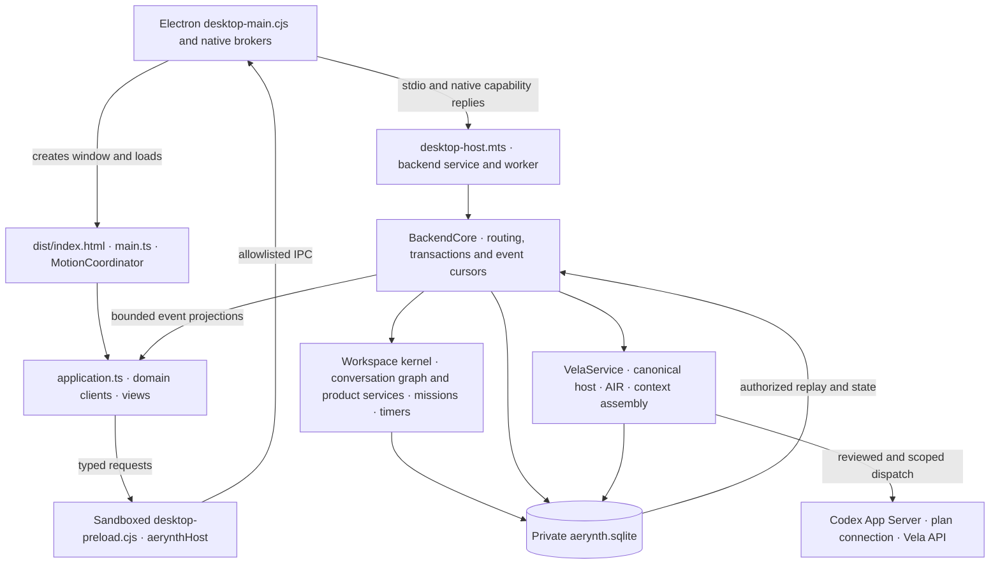

# A0/A1 runtime ownership and recovery handoff

The inventory describes the connected Windows Electron application at base `6d249eba7c1b3f8327f5a592734a5d334be1bf6e`. It is part of Program A, [Architecture Recovery](../decisions/ADR-002-ARCHITECTURE-RECOVERY-AND-COHESIVE-RUNTIME.md). Source inspection establishes the implementation and the location of regression suites. Executed checks, native application results, and provider or owner acceptance require separate evidence.

## Connected startup and request flow

- [The Electron package](../../prototypes/visual-experience/cinematic-v3/package.json) declares `native/desktop-main.cjs` as its entry. [The desktop main process](../../prototypes/visual-experience/cinematic-v3/native/desktop-main.cjs) admits storage, starts the backend child, creates a sandboxed window and authenticates the local main frame before routing commands. [The preload](../../prototypes/visual-experience/cinematic-v3/native/desktop-preload.cjs) exposes a bounded command and event surface. Native brokers handle approvals, protected secrets, OS facts, computer operations, documents, and media.
- [The renderer entry](../../prototypes/visual-experience/cinematic-v3/src/main.ts) detects the connected command bridge, creates the shared Motion Coordinator, and invokes [the application controller](../../prototypes/visual-experience/cinematic-v3/src/application.ts). The controller hydrates from the backend, holds UI projections, and replays scoped events. The historical visual entry `native/main.cjs` has a separate preload and seeded local state. It shares renderer code with the desktop host, so visual fixture behavior must be attributed to the entry that actually ran.
- [The desktop host](../../prototypes/integrated-backend/src/desktop-host.mts) dispatches through [the backend service](../../prototypes/integrated-backend/src/service.mts) and [worker](../../prototypes/integrated-backend/src/worker.mts) to [BackendCore](../../prototypes/integrated-backend/src/core.mts). The worker handles typed requests and forwards approved native host operations. Startup failure closes native clients and reports a storage or schema error. Persisted state and cursor replay are restored through the same domain interfaces.
- Local Vela requests first use host facts and eligible local tools. AIR classifies intent and selects among available routes. The canonical host resolves identity and current source versions. Provider dispatch requires its own account, context and review checks. The renderer receives canonical messages, effects and receipts through the same bridge. [AIR](../../prototypes/vela-core/src/adaptive-routing.ts) and [the canonical host](../../prototypes/vela-core/src/canonical-host.mts) define different responsibilities.

## Canonical records, projections, and verification boundaries

The default connected profile is under the application's Windows AppData folder. An explicit, absolute `--profile` selects a separate profile. The desktop places Chromium state under `chromium/` and opens `aerynth.sqlite` in the profile root. BackendCore requires local private state outside the checkout, caps the main database at 128 MiB with a DELETE journal, and uses an 8 MiB integration snapshot limit and concurrent-writer comparison. These are source limits. Journal, Chromium state and native run artifacts need their own storage admission. No actual user data was migrated, reset, or inspected for this inventory.

| Domain | Authority and durable state | Consumers and access boundary | Existing verification and remaining qualification |
|---|---|---|---|
| Projects, workspaces, resources, placement | [WorkspaceKernel schema](../../prototypes/workspace-kernel/migrations/001-initial.sql) owns stable IDs, collections, links, notes, blocks, layouts and change events. [Desktop](../../prototypes/integrated-backend/src/desktop.mts) owns kind and shape extensions, navigation, view, panels, checkpoints and undo. | Workspace engine computes layout. Application and Constellation render source-backed state. Mutations use the kernel and desktop commands with active scope and source IDs. | Kernel, engine, constellation and backend suites. Native placement and restart need same-candidate receipts. |
| Conversations, messages and ancestry | [ConversationGraph](../../prototypes/connected-conversations) holds canonical ancestry and messages. BackendCore serializes its snapshot, resource mapping, revisions, provider bindings, executions and receipts in `integration_state`. [ConversationProduct](../../prototypes/conversation-product/src/service.mts) owns `cp_*` policy, shares, drafts, collection rules, flags and saved views. | Application gets controlled views via the conversation broker and Core. Provider sessions are attachments to local identity. Resource visibility, redaction, sharing and send review govern context egress. | Graph, conversation-product, Core and broker suites. Exact current native history/restart and real provider support are separate. |
| Notes, files and related knowledge | The kernel owns note records and resource identities. [NoteExperienceService](../../prototypes/block-library/note-service.mts) owns versioned drafts against those identities. BackendCore persists file descriptors in `media_sources`. Native document and media brokers resolve the selected external source. | Notes and files feed workspaces and eligible retrieval. An application resource ID or path does not by itself grant document reading, write access, or provider disclosure. | Block-library, backend and native broker tests. OS file revocation and access need actual host evidence where claimed. |
| Manual tasks, checklists and agent profiles | [TaskObjectiveService](../../prototypes/task-product/service.mts), [ChecklistService](../../prototypes/checklist-product/service.mts), and [AgentLibraryService](../../prototypes/agent-product/service.mts) own their typed document/version/receipt tables under kernel resource IDs. | [Product domains](../../prototypes/integrated-backend/src/product-domains.mts) implement local-owner gates and canonical adapters for blocks and Vela. Manual task state is distinct from a mission attempt. | Domain service, backend and renderer suites. Native instrument gestures and restart remain separate gates. |
| Missions, attempts, tools and effects | [MissionService](../../prototypes/integrated-backend/src/mission-service.mts) owns plan revisions, dependency state, attempt scheduling and evidence in `vela_missions`. [VelaService](../../prototypes/vela-core/src/service.mts) owns `vela_state` requests and proposals. [Tool workflows](../../prototypes/integrated-backend/src/vela-tool-workflows.mts) own staged invocation fingerprints and results. | Core and native review admit scoped operations. Tool registry and canonical host resolve capability and scope before owner dispatch. Evidence and unknown effects constrain restart. | Mission, Core, canonical-host, IPC and tool contract suites. Native offline mission receipts can prove actual local execution, while provider or external effects require their own acceptance. |
| Authorization | The Electron main-frame fence and native review brokers validate the caller and approved action. Core, Vela canonical host, and domain services validate current scope, capability, resource revisions and allowed effects. Decisions and receipts are persisted with the relevant review, grant or operation owner. | Provider, renderer, model and tool selections are inputs to the trusted path. Selected file, provider and mission scopes are revalidated before effect or disclosure. | Denied, stale, unsupported and unknown-effect fixtures exist in backend, Vela, domain and broker suites. Exact native negatives are still needed for native claims. |
| Context retrieval and derived memory | Vela bounded history, lexical retrieval, mission context, and the selected-document fence compose scoped input from current source owners. [PersonalContextService](../../prototypes/personal-context/src/service.mts) defines encrypted revisions and source dependencies through an injected DB/crypto host. Source search found no connected call sites for that service. | Bounded references and context candidates may be reused within their scope. The connected runtime has no evidence of a second canonical personal fact authority. | Vela history and mission fixtures, selected-document tests, standalone Personal Context tests and governance retrieval checks. Full semantic CIE and unified native memory lifecycle are future requirements. |
| Intelligence events, timeline and Stream | BackendCore owns deduplicated `intelligence_events` with retained cursors. [TimelineService](../../prototypes/timeline-product/service.mts) owns saved views and editable planning records. Retained history, live projections and planning items carry distinct provenance. | Workspace instruments and mission views read scoped projections. The small Stream block is distinct from the required full-screen Stream V2. | Backend event, mission, timeline and renderer tests. Native receipt must establish source IDs and actual status changes. |
| Clock, timers, delivery | [TimerService](../../prototypes/timer-product/service.mts) owns documents, expiries and command receipts. [TimerDomain](../../prototypes/integrated-backend/src/timer-domain.mts) owns durable delivery receipts; host clocks provide current time. | Timer and clock views and approved Vela actions share the owner state. Reopen reconciles expiry with delivered receipts. | Timer service and integration fixtures; native expiry and restart evidence separately. |
| Provider sessions and settings | [Provider adapter](../../prototypes/integrated-backend/src/providers.mts) uses the [Codex bridge](../../prototypes/codex-bridge) to operate App Server sessions. Local binding IDs, review and execution records are in Core. [OpenAI Connections](../../prototypes/integrated-backend/src/openai-connections.mts), [Vela API connection](../../prototypes/integrated-backend/src/vela-api-connection.mts) and [API runtime](../../prototypes/integrated-backend/src/vela-api-runtime.mts) own distinct account, configuration and usage/attempt records. Electron [protected storage](../../prototypes/visual-experience/cinematic-v3/native/protected-storage.cjs) encrypts eligible secrets. | Native signed-in Codex, ordinary plan routing and API credentials have different scopes. Provider-owned history and session data stay external. Local catalogs and observed status are snapshots, with capability and authorization checked at dispatch. | Bridge fixtures and provider/backend tests. Live account, real provider requests, imported history availability and billing claims need their own qualified evidence. |
| Voice and wake | [VelaVoiceRuntime](../../prototypes/integrated-backend/src/vela-voice-runtime.mts) owns grants, sessions, fragments, groups, speech, delegation, settings and cached catalog. [VelaWakeRuntime](../../prototypes/integrated-backend/src/vela-wake-runtime.mts) owns consent and settings and uses a manifest-verified local engine and private scratch area. | Native media, wake capture and permission brokers separate microphone use and voice inference. Interrupted in-flight voice sessions retain uncertain status. | Source contracts and fixture tests; live access, mic/device behavior, native wake and voice quality require separate qualification. |
| UI preferences, motion and projections | Desktop and domain view records persist explicitly saved state. MotionCoordinator, geometry, projection caches, renderer selection and app process state are transient. Historical fixture localStorage preserves synthetic settings and drafts in its own profile. | Renderer caches represent authorized snapshots and pending UI state. Canonical commands own mutations. | App and view suites plus native restored geometry. Physical displays, performance and visual acceptance are separately gated. |

The SQLite mission event index is derived from the event table. Browser state, renderer caches, provider and voice catalog snapshots, lexical scores, and mission context score caches have distinct lifetimes. Private fixture evidence, generated renderer assets, native helper binaries, external file sources, and provider-side history are separate from authoritative application records. The source does not establish an independent durable semantic index for the connected runtime.

## Context paths to preserve

- [Bounded history](../../prototypes/vela-core/src/bounded-history.mts) supplies source versions, omissions and frozen provider request context. [History retrieval](../../prototypes/vela-core/src/history-retrieval.mts) ranks eligible canonical records with bounded lexical rules. BackendCore validates the live conversation, references and provider context before dispatch.
- [Mission context](../../prototypes/vela-core/src/mission-context.mts) composes a scoped per-attempt package from canonical mission and workspace data. Its score cache is derived. Mission plan, task, attempt, and evidence identity remain with MissionService.
- [SelectedDocumentContext](../../prototypes/integrated-backend/src/selected-document-context.mts) fences extraction to selected resources and current scope. Native extraction is an implementation boundary in addition to the domain access checks.
- [Governance Context Router V2](GOVERNANCE-CONTEXT-ROUTER-V2.md) retrieves versioned repository requirements for engineering. Its normative coverage and section-selection evaluation are separate from runtime personal-memory quality.
- The accepted [Unified Memory Runtime](../architecture/VELA-UNIFIED-MEMORY-AND-CONTEXT-RUNTIME.md), [Local-First Storage](../architecture/AERYNTH-LOCAL-FIRST-STORAGE-AND-CONTINUITY.md), and [semantic CIE contract](../specifications/CIE-SEMANTIC-INTERPRETATION-AND-EVIDENCE-RETRIEVAL.md) describe the required future coordination and lifecycle. Source ownership, egress consent, source correction, revocation, and uncertain-effect behavior remain binding.

## Debt register and next milestone

| Risk | Reproduction and cause | Impact and corrective slice | Acceptance and regression risk |
|---|---|---|---|
| High · A1 · CI | Compare the dependency imports in `integrated-backend/src/core.mts` and the desktop Vite config against [the baseline workflow](../../.github/workflows/integrated-backend.yml) and [the existing cross-package runner](../../scripts/run-aerynth-acceptance.mts). App-only and Vela-Core-only paths can miss the former. | Extend the trigger to the actual dependency closure and exercise consumers. Build the real desktop on Windows with its native prerequisites. | Synthetic and Windows-build jobs must report independently. Native desktop interaction requires the Windows reserve guard, an interactive desktop and an owned profile. |
| High · A1 · Developer commands | In the cinematic package, compare `main` and `scripts.record`/`scripts.soak` with the flag readers in `native/main.cjs` and `native/desktop-main.cjs`. The connected entry rejects the documented `--integration-live` flag. | Point visual-harness commands to the visual entry and document connected verification separately. The incorrect route can start the normal desktop profile. | Assert intended command targets and verify isolated fixture behavior. Avoid opening the normal user profile to reproduce the bug. |
| High · A2 · Integration transactions | Inspect `BackendCore.atomic` and `save` near lines 4940–4958 at base. Every atomic mutation clones state and snapshots the graph, and save serializes and compares the full bounded integration record. | Measure cost and size against owned fixtures before choosing one service boundary for extraction. The snapshot check and rollback currently couple graph, provider effects and several review states. | Keep exact IDs, transaction rollback, event publication order, concurrent-writer rejection, restart, and unknown-effect behavior. Do not migrate user state in A0/A1. |
| Medium · A2 · Routing ownership | Compare `routeVelaNative`, `selectVelaRoute`, ordinary conversation sends and mission admissions in Core. Review selected-document and canonical-host fences alongside them. | Document route entry, authorization owner, inputs, fallback and effect owner before consolidating any repeated mechanics. Several gates serve separate trust boundaries. | Exercise native and provider routes against the same scope matrix. Reject stale/revoked access and preserve separate account and egress approvals. |
| Medium · A2 · Renderer coordination | Inspect `application.ts` hydration, event replay, active workspace selection, projection caching and motion wiring. The connected and historical surfaces share `main.ts`. | Trace one projection's lifecycle and narrow its responsibility only after proving where its cache diverges or its update order is fragile. | Check reconnect cursor gaps, workspace switches, restored geometry, interruption, and motion continuity in the real host. Shared visual code should continue serving both entries. |
| Medium · A3 and Full Realization · Context readiness | Compare standalone Personal Context, mission context, bounded history, document selection and canonical retrieval against the unified lifecycle. These are partial owners and retrieval paths with different purposes. | Inventory interfaces and baseline the retrieval quality in A3. Full Realization owns production semantic interpretation and learned memory. | Use independent held-out paraphrase, stale-source, correction and privacy scenarios. Preserve model-free exact lookup and canonical source authority. |

Historical [application integration](AERYNTH-APPLICATION-INTEGRATION-STATUS.md), [AIR](VELA-AIR-STATUS.md) and [Living Instruments](LIVING-INSTRUMENTS-STATUS.md) reports retain evidence for their stated checkpoints. Use exact current source and native receipts for candidate qualification. One continuous spatial universe. No disconnected screen changes. This inventory preserves the owner-ratified GPU Presence and full-screen Stream V2 requirements.
