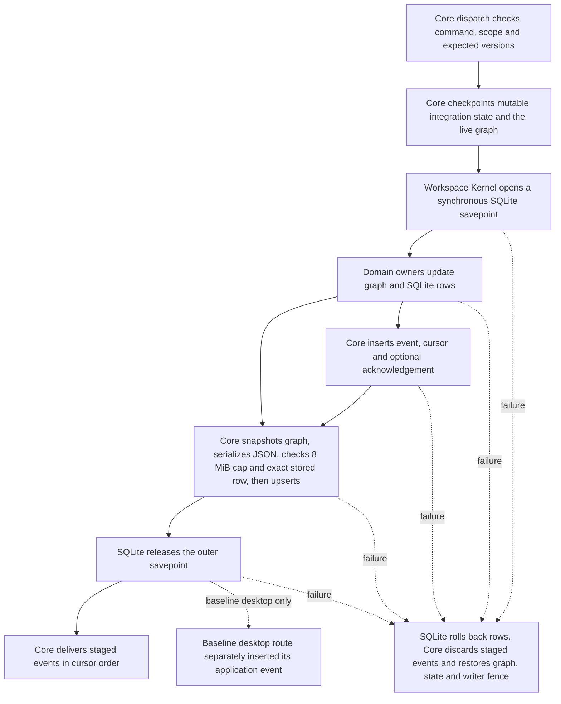

# A2.1 transaction and persistence coordination

Program A, Architecture Recovery. The implementation starts from [PR #25's merge on main](https://github.com/Kgray44/Aetherwake/commit/58c17f0b0db023fb1f0ecfa7b51d50cc0c9d14f2). [ADR-002](../decisions/ADR-002-ARCHITECTURE-RECOVERY-AND-COHESIVE-RUNTIME.md), the [ratified registry](../../governance/README.md), and the [storage](../architecture/AERYNTH-LOCAL-FIRST-STORAGE-AND-CONTINUITY.md) and [memory](../architecture/VELA-UNIFIED-MEMORY-AND-CONTEXT-RUNTIME.md) contracts remain authoritative. The A0/A1 inventory is historical. [Source ownership at A0/A1](A0-A1-RUNTIME-OWNERSHIP.md)

## Transaction lifecycle



The desktop main process sends a typed command through the worker to [BackendCore](../../prototypes/integrated-backend/src/core.mts). Admission and scope checks belong to the individual command and its owner. Some occur inside the transaction so a refusal sees the same canonical state as the operation. Provider and native work that awaits a result crosses separate durable boundaries for admission, effect evidence and final reconciliation. The SQLite transaction callback remains synchronous.

| Stage | Owner and state | Failure and visibility |
|---|---|---|
| Checkpoint | Core captures mutable integration metadata and the last accepted JSON, and asks ConversationGraph for the current live graph. The last saved graph projection is detached from the live graph. | Each nested call has its own checkpoint. Restore values into retained execution and review objects so awaiting provider callbacks retain canonical identity. |
| Domain write | [WorkspaceKernel](../../prototypes/workspace-kernel/kernel.mts) supplies savepoints on one SQLite connection. ConversationGraph owns IDs, messages and ancestry. Workspace, conversation policy, mission, timer, Vela and other domain services write their own tables or authorized integration records. | SQLite savepoint rollback undoes canonical SQL writes. Nested release stays inside the enclosing transaction. Timer writes share event coordination without invoking the integration snapshot save. |
| Durable record | Core saves the ConversationGraph projection, ID mappings, revisions, bindings, effects, handoffs, provenance and command receipts in the existing single-row `integration_state` envelope. Other domain tables retain their own authority. | Exact comparison against `storedJson` rejects stale Core writers even for an otherwise unchanged save. Serialization, size, SQL or release failure restores the checkpoint. DELETE journal, 128 MiB main database cap and 8 MiB UTF-8 integration limit retain their existing behavior. |
| Observation | The event table, durable latest cursor, retention, deduplication and optional acknowledgement are written together. The pending array is transient. Core publishes through its existing observer and attention paths after release. | Live delivery errors leave replay authoritative. The drain preserves cursor order when a synchronous observer causes another commit. |
| Restart | Core loads the durable row, reconstructs the live graph, validates identities and mappings, and reopens domain tables. Mission, Timeline, Stream, workspace and desktop views project the canonical records. | Interrupted provider attempts retain unknown outcomes and are reconciled through the original contracts. The mission cursor index, view projections and caches are derived. |

At baseline, each normal atomic call copied the saved graph inside `structuredClone(state)`, copied the live graph for rollback, then copied the resulting graph for persistence. A workspace mutation paid these costs even when it changed only workspace rows. The integration envelope was then serialized, read back as a whole for the writer check, and upserted. The candidate retains the read-only saved projection by reference and still checkpoints the live graph separately. All observed writers replace the saved projection wholesale. The two snapshots represent distinct points during a nested call.

The baseline desktop mutation committed before the separate application event write. An injected journal error returned a rejection with a durable conversation. The baseline delivery loop also let a synchronous observer deliver a later cursor ahead of an already committed event. Both failures were reproduced on the [unchanged baseline](https://github.com/Kgray44/Aetherwake/actions/runs/42748817442). The desktop mutation and observation now share one transaction. Core and timers use the same staging and drain implementation. The preset preference path captures its event identity before invoking observers. The rollback callback runs only for a transaction failure, and delivery catches failures per event so the rest of the batch can proceed.

Incremental SQL, dirty tracking, selective live-graph checkpoints and schema changes would require new ownership and compatibility rules. This patch keeps full serialization and the exact writer fence. A no-op save continues to issue the same integration upsert. The implementation removes one graph copy and duplicate event staging code without adding a second transaction or persistence authority.

## Paired measurement

Run from the repository root with Node 24.18.0.

```sh
node prototypes/integrated-backend/src/transaction-benchmark.mjs
```

For baseline, copy the benchmark script into the same path in an isolated checkout of `58c17f0`. The [paired hosted run](https://github.com/Kgray44/Aetherwake/actions/runs/42749341351) ran that script on baseline and candidate `1c2b18b` on the same Linux x64 runner, AMD EPYC 9V45 with four available logical CPUs. It ran baseline first, then focused tests, then candidate. Each operation has four warmups and 24 retained samples per profile. The p95 uses nearest rank. Each profile has its own disk-backed synthetic database. History grows within each bounded arm. Reopen compares the persisted JSON representation of the graph and verifies workspace and mission IDs. Mission pause measures a real local owner transition before worker admission. The stale-writer arm uses two real connections with deterministic ordering.

| Profile | Seed messages × bytes | Generic resources | Seed events | Initial JSON bytes | Workspace-create median, ms | p95, ms | Worst, ms |
|---|---:|---:|---:|---:|---:|---:|---:|
| Almost empty | 0 | 0 | 0 | 2,554 | 1.10 → 0.93 | 1.22 → 0.99 | 19.49 → 1.04 |
| Small | 24 × 256 | 8 | 24 | 14,042 | 1.17 → 1.05 | 1.55 → 1.36 | 15.88 → 15.61 |
| Moderate | 72 × 1,024 | 40 | 120 | 92,330 | 1.38 → 1.26 | 1.62 → 1.39 | 4.49 → 16.05 |
| Conversation-heavy | 512 × 4,096 | 8 | 24 | 2,214,290 | 10.47 → 9.56 | 17.11 → 18.58 | 23.91 → 31.67 |
| Workspace-heavy | 24 × 256 | 180 | 120 | 14,042 | 1.10 → 0.98 | 1.19 → 1.05 | 1.26 → 1.10 |
| Event-heavy | 24 × 256 | 8 | 512 | 14,042 | 1.09 → 1.08 | 2.55 → 1.41 | 18.05 → 15.54 |
| Near integration limit | 120 × 58,000 | 40 | 120 | 6,989,330 | 29.12 → 23.71 | 35.97 → 38.26 | 40.71 → 45.88 |

The event-heavy fixture also seeds six terminal local missions. The placement arm measures workspace creation plus a separate attachment command. Generic-resource seeding exercises the SQL owner and remains separate from conversation history in the envelope.

| Metric | Baseline | Candidate | Change |
|---|---:|---:|---:|
| Small workspace-create median | 1.173 ms | 1.053 ms | −10.2% |
| Small workspace-create p95 | 1.549 ms | 1.363 ms | −12.0% |
| Near-limit workspace-create median | 29.119 ms | 23.713 ms | −18.6% |
| Near-limit workspace-create p95 | 35.969 ms | 38.260 ms | +6.4% |
| Near-limit workspace-create checkpoint clone median | 1.054 ms | 0.052 ms | −95.1% |
| Near-limit graph snapshot median, summed per workspace create | 4.866 ms | 1.973 ms | −59.5% |
| Near-limit JSON stringify median | 5.950 ms | 6.860 ms | +15.3% |
| Near-limit save median, inclusive | 22.015 ms | 21.097 ms | −4.2% |
| Near-limit outer SQLite RELEASE median | 1.121 ms | 1.118 ms | −0.3% |
| Near-limit substantial save p95 | 77.445 ms | 70.402 ms | −9.1% |
| Near-limit reopen plus snapshot median | 174.763 ms | 180.436 ms | +3.2% |
| Near-limit final integration bytes | 7,948,050 | 7,948,050 | 0 |
| Near-limit workspace-create logical changes median | 4 | 4 | 0 |
| Cumulative process peak RSS through final profile | 1,017,808 KiB | 1,056,216 KiB | +3.8% |

Near-limit final database size on the candidate was 17,035,264 bytes with 233 retained events at the pre-reopen measurement point. The run approaches the 8 MiB JSON ceiling. The UTF-8 fault test crosses that ceiling. It does not attempt to fill the 128 MiB database. Logical SQLite changes include rolled-back rows and do not measure physical writes. Stage timings overlap, outer release is a timing proxy for commit, and peak RSS covers the process rather than an individual operation. The workspace-create clone improvement also appeared in the [earlier paired run](https://github.com/Kgray44/Aetherwake/actions/runs/42749119739), where near-limit p95 moved in the opposite direction. Event-heavy substantial-save p95 increased from 8.92 to 17.88 ms in the final pair. The data supports removing the duplicate checkpoint copy. Latency tails, reopen cost and peak memory are mixed. The benchmark does not establish GUI responsiveness or a system-wide speedup.

## Invariant and fault ledger

| Invariant | Owner | Evidence |
|---|---|---|
| Authorization precedes durable effects | Core command owners, native review and canonical source policy | `integration.test.mts` approval denial, wrong scope, stale revision, fingerprint, expiry, source revision and malicious-context negatives. `workspace-recovery-integration.test.mts` archived-project denial and review invalidation. |
| Mutation, save and observation commit atomically | Core, WorkspaceKernel and DesktopState | `transaction-coordination.test.mts` SQLite event trigger rolls back the desktop conversation across reopen. Nested rollback retains unsaved outer graph state until outer rollback. Circular serialization and UTF-8 size rejection leave graph, resource and event state unchanged. |
| Commit failure restores the fence and all staged changes | Core and SQLite | Deferred foreign key fails outer RELEASE after the integration upsert. The focused test verifies row, graph, revision, event and fence rollback, retries and reopens with one committed event. |
| Concurrent writer protection | Core durable JSON comparison, SQLite savepoints, owner version checks | Focused stale unchanged-save rejection and a second connection attempting a write while the interrupted child holds its SQLite write lock. The benchmark uses a deterministic ordered conflict. |
| Stable canonical identity and lineage | ConversationGraph, WorkspaceKernel, DesktopState | `desktop.test.mts` persistent geometry, reattach, undo and trusted graph ancestry. `integration.test.mts` persistent journey and resource identity across provider and parent changes. |
| Live cursor order, deduplication and replay | Core and event journal | `canonical-event-commit.test.mts` outer release and reentrant ordering, `transaction-coordination.test.mts` publisher fault and subsequent write, `vela-integration.test.mts` preset provenance under a reentrant observer, and `integration.test.mts` dedupe, retention, unsubscribe and gap reporting. |
| Unknown external effects stay unknown until reconciled | Existing Core execution and provider owners | `integration.test.mts` process loss, exact native turn recovery and no resend through a fixture App Server. `vela-integration.test.mts` uncertain native receipt requires new review. Live provider execution is outside these tests. |
| Restart selects committed state | SQLite, Core and mission service | Focused process kill after save but before RELEASE, and after RELEASE during delivery. Reopen verifies zero or one conversation and event accordingly. `mission-integration.test.mts` independently interrupts a worker after durable admission and verifies paused recovery. |
| Mission event and evidence fidelity | Mission service and Core event projection | `mission-publication.test.mts` acknowledgement rollback and bounded replay. `mission-integration.test.mts` scope, attempts and same-profile evidence. |

The first hosted benchmark attempt failed because its reopen comparison treated missing JSON keys and JavaScript keys set to `undefined` differently. The corrected script compares the canonical JSON representation. The subsequent baseline completed all seven profiles and showed two intended regression failures. Both now pass with the candidate, together with the eight other focused tests. An independent reviewer found that the first candidate could route a post-commit exception into rollback, and that preset event attribution could share a mutable event reference. The revised candidate restricted rollback to the transaction catch and snapshots the event identity before delivery. Re-review found no remaining high or critical issue. The benchmark review identified fixed arm order, stage overlap and cumulative RSS as interpretation limits.

## Verification

The [integrated workflow](../../.github/workflows/integrated-backend.yml) and [governance workflow](../../.github/workflows/governance-router.yml) provide exact-head hosted checks on the PR. The integrated workflow runs the following commands with locked dependencies. Its Windows build and synthetic suites run separately from the interactive desktop ledger.

```sh
node scripts/governance-router.mjs --validate
node --test tests/governance-router.test.mjs tests/governance-context.test.mjs
node scripts/benchmark-governance-context.mjs
node scripts/evaluate-governance-engineering.mjs --strict
node --test prototypes/integrated-backend/tests/canonical-event-commit.test.mts prototypes/integrated-backend/tests/transaction-coordination.test.mts
npm --prefix prototypes/integrated-backend run typecheck
node prototypes/integrated-backend/node_modules/typescript/bin/tsc --project prototypes/vela-core/tsconfig.json --typeRoots prototypes/integrated-backend/node_modules/@types
node --test "scripts/review-*.test.mjs"
node scripts/run-aerynth-acceptance.mts
```

See the [native ledger](A2-1-NATIVE-VERIFICATION.md) for commands, exact revision and private receipt references.

## A2.2 handoff

- Map application, workspace recovery, provider and mission command admission before consolidating routes. Keep scope, revision, current consent and source readback with the canonical owners. Re-run the fault ledger when moving a route across a commit boundary.
- Audit ordinary Responses terminal recording and cleanup. The existing terminal event write precedes clearing active runtime handles. A failing event write after durable settlement can suppress cleanup. Add fault injection at that boundary before changing provider coordination.
- Inventory remaining standalone event producers and mission publication acknowledgements. Preserve once-only claims, unknown effects and replay ordering before unifying their entry points.
- Keep the remaining full integration serialization, retained event-table scaling and per-operation allocation measurement in the A2 persistence backlog. The current paired data and invariant tests do not establish a need for schema changes.
