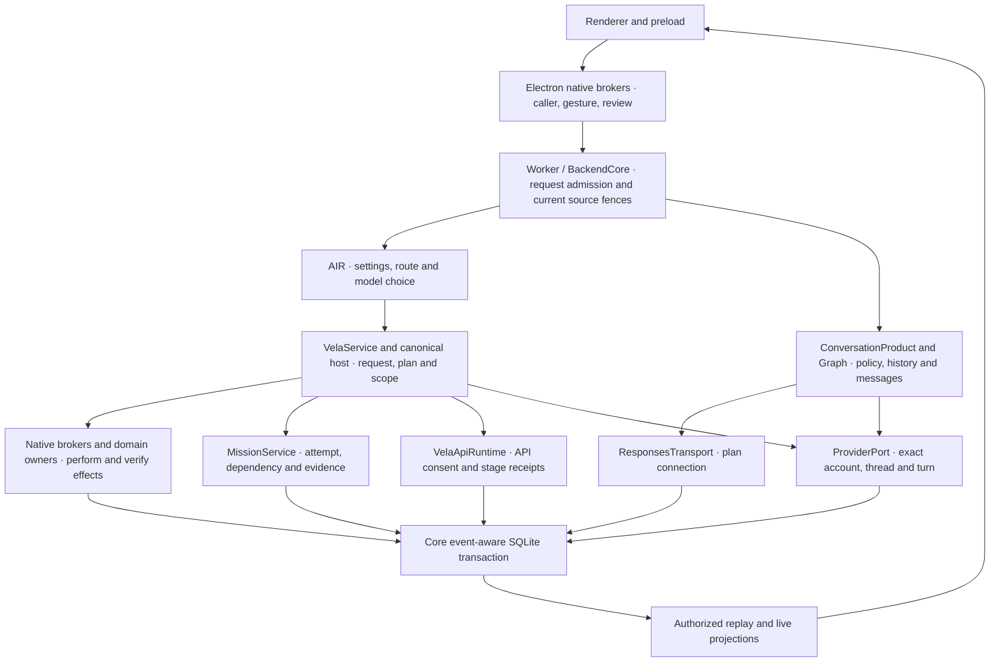

# A2.2 routing, authorization and execution coordination

Program A, Architecture Recovery. The starting commit is [merged A2.1](https://github.com/Kgray44/Aetherwake/commit/3fbb421a743d989993fae8c5d16f8e87e045383c). [ADR-002](../decisions/ADR-002-ARCHITECTURE-RECOVERY-AND-COHESIVE-RUNTIME.md), the [binding registry](../../governance/README.md), the [execution fabric](../architecture/VELA-CAPABILITY-RUNTIME-AND-EXECUTION-FABRIC.md), the [provider contracts](../specifications/VELA-PROVIDER-TOOL-AND-AGENT-CONTRACTS.md) and the [Unified Memory Runtime](../architecture/VELA-UNIFIED-MEMORY-AND-CONTEXT-RUNTIME.md) govern the change. The [A0/A1 inventory](A0-A1-RUNTIME-OWNERSHIP.md) identifies storage owners. [A2.1](A2-1-TRANSACTION-COORDINATION.md) supplies the Core transaction and replay guarantees.

## Route and authorization matrix

| Entry and decision owner | Admission, scope and dispatch | Terminal state, cleanup and recovery |
|---|---|---|
| Ordinary Vela text. Native Vela broker calls `velaRouteNative` then `velaRequestPreview`. VelaService owns the request, conversation and accepted input. | The broker admits a trusted frame and gesture, and uses a native review or eligible routine Send. Core revalidates the frozen grant, route, provider and source refs. AIR decides route and model. | The selected owner returns attributed output. VelaService adopts only validated results into canonical Vela history. Cancellation belongs to the request and its current provider handle. |
| Local facts and ordinary local text. Core and the local host match exact facts, direct clock requests, and local appends. | Typed local facts use current measurements. Local chat appends through the conversation owner with its expected revision. Exact local work requires zero provider calls. | Native fact receipt, local message ID and canonical revision survive reopen. Previous clock pairs are omitted from later ordinary provider history. |
| Automatic or pinned inference. Core resolves AIR settings across global, workspace, agent and turn scope. | The shared API destination predicate selects explicit API or qualified unpinned API. Account catalog, effective model/effort and consent are checked separately. Codex requires its own observed capability. | The provider-specific owner settles and retires the attempt. Bounded opted-in same-provider escalation is an existing separate decision. |
| Ordinary reviewed conversation Send and Vela's signed-in plan route. ConversationProduct and Core bind a preview and one-use grant. | Core checks expiry at consumption and context at dispatch. The plan connection supplies protected credentials and the qualified catalog. ResponsesTransport posts stateless bounded context and observes remote identity. | Core commits the execution, output evidence, optional handoff and journal together. Abort retires only the owning handle. Incomplete output is marked partial when authorized. A failed write leaves a truthful unknown record when possible. |
| Vela API. The native grant and VelaApiConnection own configuration and billing consent. | VelaApiRuntime checks version, usage grant, model, quota, tool/schema receipts and scoped continuation. Core owns the canonical execution. A stage needs a committed admission before credential resolution and POST. | Core and runtime commit the receipt, execution and event together. Workflow and canonical conversation adoption are separate. The runtime releases its lane in finally. Restart converts interrupted admissions to unknown. |
| Explicit Codex and managed Codex conversation Send. AIR or the fixed conversation provider chooses Codex. | Core validates source policy for shared history, grant, resource revision, account instance and binding. ProviderPort binds the exact native thread and turn. Codex planning and inspected file work keep their native review and capability gates. | Provider terminal identity precedes canonical settlement. Managed Send rechecks source permission before dispatch and output disclosure. Old-turn notifications do not attach to a newer bound turn. Read-only recovery uses exact native IDs. |
| Voice. Native voice broker and VelaVoiceRuntime own capture/session consent and transcript identity. | Configuration, selected scope and the sealed transcript gate delegation to the same native or reviewed provider path. | Voice state owns capture and session shutdown. Text/provider result adoption still belongs to VelaService. No extra conversation authority comes from speech. |
| Native capability and approved workspace operation. Core route and canonical host resolve typed plans. | Source owners enforce target revision and operation scope before effect, including after awaited preparation. Mutations use the domain transaction and owner readback. | Domain receipt establishes the effect. Unknown outcomes require owner reconciliation. Provider proposals and operation evidence retain separate provenance. |
| Mission. MissionService owns plan, attempts, dependencies and evidence. | Native review, authorized workspace, storage admission and worker capacity are distinct checks. Scoped specialist routes bind their own provider and tool authority. | Evidence determines verified outcome. Interrupted workers recover as paused or unknown, without blind replay. Workroom and Stream publish scoped projections. |
| Selected document/file. SelectedDocumentContext and native document/media brokers resolve the selected resource and external revision. | Read grant, provider disclosure and reviewed effect are separate. Tool workflows bind the precise target, digest, proof and one-use owner approval. | Source owner records readback or uncertainty. Revocation invalidates current context. Restart recovery follows the original owner and receipt. |
| Resume and handoff. ConversationGraph and ConversationProduct own lineage, context policy and messages. | Scope, source digest, target branch, current consent and provider binding revalidate. A missing receipt requires explicit review or reconciliation. | The original execution identity survives restart. An uncertain provider effect stays unknown until readback supports a stronger state. |

The Electron broker enforces caller, gesture and native consent. Core enforces dispatch admission and freshness. Domain owners enforce current access and effects. Provider capability catalogs, protected credentials and billing grants retain distinct authorities. A preview carries review data and no standing authority. Synchronous disclosure checks read the same canonical source policy used during request preparation.

## Implementation decisions

- Ordinary Responses previously committed its terminal execution and message before a separate journal insert. An insert failure left the runtime active and the caller rejected despite committed output. The existing Core atomic boundary now includes the journal write. An aborted commit can record unknown in a second local transaction, without another provider dispatch. If that also fails, the first exception survives and restart reconciles the durable admission.
- Vela API previously nested a Core transaction inside the runtime's raw SQLite savepoint. It could emit completion before the actual commit and leave the in-memory writer fence ahead of SQLite. Admission and terminal callbacks now run under the Core execution transaction. Runtime-only SQL continues to use the kernel transaction. The runtime discards uncommitted answer and tool output on failed settlement, preserving only bounded receipt metadata and conservative status.
- Native notification and provider state have separate failure handling. Live text observers are isolated after the redacted event row is recorded. Replay remains ordered and metadata-only. An ordinary response callback abandoned on cancellation cannot journal to a later active execution. Codex filters late events with a mismatched bound turn and releases discovery separately from the retained proof.
- Managed Send checks grant expiry after context preparation. Ordinary and managed Codex share a current-source fence at dispatch and disclosure, preserving provider-specific connection checks. Managed Codex handoff preparation also applies the canonical branch policy. On loss of scope during a run, a terminal notification alone does not authorize disclosure or recovery of the revoked context.
- The native and AIR gates previously differed on model- or effort-only pins with an authorized API. Both now use the same destination predicate. Exact native facts and reviewed local operations remain available. Automatic and explicit API selection still use independent capability and billing checks.

No new router, journal, scheduler, persistent schema or authorization authority was introduced. Event cursor retention, one-use receipts, SQLite rollback and the concurrent-writer fence remain owned by A2.1's existing coordination.

## Fault and acceptance ledger

| Fault or route | Verification and expected evidence |
|---|---|
| Ordinary completion journal insert fails | Disk-backed SQL trigger rolls back assistant message/evidence and completion event. Unknown state and event commit together. The original grant stays consumed. A fresh reviewed Send can run. |
| Ordinary completion and fallback journal inserts both fail | First error reaches caller. Durable admission retains response identity and no assistant message. There is no synthetic running or completion event. Active task/controller are retired and reopen projects unknown. |
| Ordinary observer disconnects on delta and terminal | Both deliveries fail after canonical recording. Exact completed execution and output evidence survive restart. Replay from the prior cursor is ordered and contains metadata only. |
| Vela API deferred foreign key rejects terminal release | Core and API receipt settle together as unknown. No live event escapes the open transaction and no completion appears in replay. Exact receipt survives restart and one-use admission stops duplicate POST. |
| Vela API deferred admission release fails | No grant consumption, execution, POST, admission event or request count. An admission observer also cannot start another foreground execution before the API slot is reserved. |
| Native Send expires while preparation is paused | No provider call, execution or message is admitted. The expired grant remains unconsumed. |
| Managed Codex loses an attached source while terminal retrieval is held | Live activity suppresses the accumulated text. Durable settlement keeps the provider binding and turn as unknown and withholds assistant output across reopen. |
| Ordinary callback resumes after interrupt and a successor POST | Replay and live delivery keep the old response identity out of the successor. The old request remains unknown and the new one settles independently. |
| Codex prior-turn delta arrives during a newer bound turn on the same native thread | Replay attributes only the matching delta to the new execution. Exact terminal output and native IDs are preserved. |
| Exact local, explicit provider, absent capability, native effect, selected-file, voice, mission, cancellation and restart | Existing cross-package fixture groups exercise the real owner boundaries. Fixture providers and simulated model responses establish contract behavior. Windows Electron evidence and CI have separate receipts. |
| A2.1 transaction regressions | Focused rollback, UTF-8 ceiling, nested/deferred commits, event insert/delivery, concurrent writers, ordered replay and crash/reopen suites remain applicable. |

The independent baseline investigation reproduced the late response-created and Codex event attribution defects. Both disk-backed regression tests fail against the merged A2.1 implementation and pass with the candidate. The [native and integration ledger](A2-2-NATIVE-VERIFICATION.md) records the commands and receipts. The new durable settlement boundary requires journal insertion on the ordinary path and the Core snapshot for API stage commits. No comparative latency improvement is claimed. Production live-provider and physical-input qualification remain separate.

## Paired local fast-path measurement

On Windows x64 and Node 24.18.0, an offline fixture used the normal `velaRouteNative` command for “What is 15% of 240?” on the merged base and `f8cc8bb`. Each arm used a fresh disk-backed SQLite profile, four warmups and 20 measured calls. Arm order was base, candidate, candidate, base. Every call returned 36 and both arms issued zero provider requests.

| Runtime | Samples | Minimum | Median | p95 | Maximum |
|---|---:|---:|---:|---:|---:|
| Merged A2.1 | 40 | 8.087 ms | 9.905 ms | 11.729 ms | 14.653 ms |
| A2.2 | 40 | 7.319 ms | 9.338 ms | 10.738 ms | 15.178 ms |

These measurements include canonical local persistence and were collected while other verification work was active. They do not isolate route selection or qualify streaming and provider latency. The private receipt is `route-paired-f8cc8bb.jsonl`.

## Final routing integrity audit

The matrix describes current contracts and the evidence available at A2.2. Provider rows use deterministic protocol or HTTP fixtures with real Core admission and persistence. A catalog fixture establishes routing behavior and does not certify production entitlement or answer quality. Source owners are listed in the route matrix above.

| Case and effective controls | Expected route and decision owner | Admission, dispatch and observed evidence |
|---|---|---|
| Auto, authorized Vela API, no provider/model/effort pin | Core selects the API, with catalog-qualified default Luna and a supported effort for the route | Native usage consent and exact scope fence gate the synthetic Responses POST. The execution and API receipt retain model and response ID. The fixture covers exact wire controls. |
| Auto, API unavailable and signed-in Responses available | Core AIR selects a supported plan model for quick or deep work | Protected plan credential and live catalog revalidate before POST. Tests bind quick and deep effort to the HTTP body. Synthetic answers retain simulated evidence and cannot become real provider provenance. |
| Explicit signed-in Responses, API also eligible | Keep the selected plan provider and resolve its model/effort | Exact preview, native authorization and protected account checks. The ordinary fixture records one POST, exact selected model and canonical execution without a Codex call. |
| Explicit API, or explicit API model and effort | Keep the API destination and validate both controls against that adapter | The test captures the exact model and effort in the POST. Unlisted models, unsupported effort, absent authorization and revoked billing consent produce no inference. |
| Explicit Codex or Codex mode with conflicting inherited Responses pins | Core resolves Codex and drops only incompatible lower-priority pins. Contradictory pins in the same layer fail closed | The App Server fixture checks native grant, actual turn, model/effort controls, one dispatch and exact provider identity. No plan-provider credential or fallback POST is used. |
| Exact local fact with disconnected providers or saved model pins | Native fact owner handles clock, memory or calculator without model selection | Tests exercise actual commands, canonical results and restart. Calculator fixtures return 36 with zero provider calls. |
| Auto exact workspace title or selected folder metadata | Local owner resolves a unique current workspace or the selected folder | No API dispatch for exact unpinned navigation. Folder authority stays with the selected native source and is rechecked after read. Compound or ambiguous wording remains eligible for provider interpretation. |
| Exact or reviewed native mutation | Canonical host resolves the typed action; owner policy and review determine whether an effect can run | Checklist, timer, selected-file and workspace tests exercise owner writes, review, denial, readback and restart. Provider schema discovery alone grants no write. |
| Model-only, effort-only or both pinned | Settings resolver preserves effective pins; plan/API/Codex adapters accept only qualified controls | Model-only does not suppress an exact native checklist route. Ordinary effort-only defaults are checked against supported models. A Codex turn with only an effort pin selects a currently qualified catalog model, preferring the qualified default. Saved Codex model/effort controls still validate as a bound pair. Unsupported combinations send no POST. |
| Global, project, workspace and chat defaults; agent and turn overrides | Resolver layers saved scope then validated agent then the turn. Explicit reset ignores inherited inference defaults | Tests compare effective settings and origins, real provider body, changed profile/agent rejection, and restart. The approved API turn controls and agent version are rechecked across owner-backed context advances. |
| Missing capability, expired catalog, disconnected provider or disabled billing | Provider authority rejects or refreshes the same destination within its contract | Existing catalog TTL fixtures exercise refresh, pin preservation, cancellation, disconnect, revoked consent and credential rotation. No surprise paid or Codex fallback on explicit selection. |
| Concurrent foreground work or changed source scope | Core ownership and domain policy gate admission, dispatch and disclosure | Reentrant observer cannot admit Codex during API admission. Paused Send expiry and post-dispatch revocation fixtures assert no inappropriate dispatch or assistant output. |
| Cancellation, late callback or restart after an uncertain effect | Transport and source owners retain original request, response or turn identity | Confirmed interruption differs from a requested abort. Late retired events do not acquire the successor's ID. Restart preserves unknown and does not repeat the POST or turn. |
| Advice mentioning Codex or file edits; recognizable local execution in the wrong lane | Clear advisory paraphrases remain conversational. A plan Responses route cannot satisfy an explicit local read/write | Held-out advice performs one ordinary fixture POST without Codex. Imperative repository inspection or file changes reject before model dispatch when the selected lane lacks local execution. |
| Informational, explicit no-change, conditional approval or mismatched creation | Tool owner returns a typed denial for read-only requests. Insufficient standing effect evidence goes to existing native review | Adversarial valid-schema calls leave workspace and navigation unchanged. A direct compound request with an API override still records two verified owner effects. |

The decision evidence comes from existing preview and route records, not model reasoning. Effective settings and origins appear in the frozen preview. Core records provider, route, qualified controls, correlation ID and measured route or stage timing where observed. Provider receipts retain dispatch and terminal state. Local source owners supply effect evidence. Denied or unavailable routes do not imply a dispatched request. Cost and model-quality claims require separate evidence.

### Codex event and lifecycle acceptance

The App Server adapter assigns a connection-wide sequence. Core now rejects known retired turn identity before attributing an event or emitting a gap. A retired event can consume only the next observed position on that connection. It cannot leap over a hole or move the current watermark backward. A two-turn regression covers pre-binding and bound retired events, independently identified valid deltas, exact replay and live IDs, and a genuine missing sequence. Bridge event IDs are retained as native metadata without text in replay.

A catalog handler release fault leaves the closed lease unusable, records a bounded diagnostic, and allows terminal evidence and schema proof to survive. Final teardown retries release. The regression uses the actual synthetic App Server and proves two release attempts, zero retained leases and identical provider completion after reopen. Existing terminal, fallback, notification, cancellation, late callback, source revocation, concurrent admission and unknown restart cases remain in the regression set.

### Full Vela AIR Realization: Requirements, Gaps, and Future Acceptance

| Status | Current boundary and future gate |
|---|---|
| Implemented and verified offline | Exact local facts, scoped settings precedence, provider/model/effort pins, native review, controlled Codex and API admission, held-out denial cases, deterministic receipt/restart behavior, and finite same-provider escalation under opt-in. |
| Implemented with incomplete qualification | Account catalogs, native App Server and provider transports require live entitlement, retention, tool availability and supported model/effort evidence for each configuration. Connected Windows media, physical input, expanded renderer navigation and production load remain separately qualified. |
| Known bounded behavior | Lexical intent guards recognize a limited grammar. Standing policy still relies on typed owner checks and separate review when action evidence is insufficient. Exact capability attribution is stronger than semantic intent coverage. Provider-proposed populated workspaces, ambiguous targets and effects outside bounded standing creation clauses go to exact native review. Standing provider timer creation accepts one stopped timer. Multi-operation or auto-start bundles require exact review. Exact direct local owner paths remain available. |
| Adaptive model and reasoning selection | Qualify supported reasoning tiers and provider/model capabilities independently. Evaluate adaptive ranking against fixed baselines on held-out tasks, reliability and authorized cost. A fast/deep preference and hard-coded default do not establish quality-adjusted selection. |
| Context intelligence | Implement evidence-needs interpretation, conflict/revision detection and independently measured retrieval across authorized sources. Preserve exact fast paths and current source/billing boundaries. |
| Orchestration and continuity | Qualify heterogeneous durable checkpoint and handoff contracts, review renewal, worker loss, cancellation and uncertain outcomes. Test one canonical Vela identity across routes, providers and restart with no provider-history conflation or blind retry. |
| Performance and cost | Measure route, capability, admission and settlement distributions across qualified hosts and real workloads. Compare verified outcome quality per unit of latency and cost with reported usage and entitlements. Keep unobserved cost and unsupported capabilities explicitly unknown. |

### Merge qualification follow-up

Review of `c900191` reproduced standing tool effects that exceeded the user's request. Core now requires every creation clause to match its bounded grammar before it considers standing execution. Conditional, deferred and ambiguous proposals use the existing exact owner review. A same-kind follow-up checks canonical plan state, so a new invocation identity cannot spend the same creation instruction twice. Explicit local placement binds to the active workspace even when a title is supplied. Timer proposals use the existing timer intent parser to bind the requested duration and current destination, including spoken duration phrases. A timer requested “there” after workspace creation requires that request's applied workspace receipt before it can use standing authorization.

The disk-backed tool tests cover withheld authorization, a condition introduced after punctuation, a different object containing a workspace reference, distinct invocation IDs, wrong timer duration and a timer proposed before its requested destination exists. The existing named-workspace, readback and ordered workspace-plus-timer journeys exercise the positive path.

## A2.3 handoff

- Reconcile live cursor delivery against Core replay's `after`, `earliest`, `latest`, and `truncated` contract. The Electron broker currently supplies a bounded latest slice. Exercise missed delivery, retention gaps and reconnects with authorized scope changes. Use the journal and canonical readback as the owners.
- Use conversation activity and Vela request state to retire the busy indicator. Exercise a dropped terminal notification, foreground cancellation, visibility revocation and restored unknown status. Keep transport and host-effect states distinct.
- The expanded Windows harness rejected the drag target because a conservative workspace envelope covered all candidate points. The renderer uses a closest mesh-ray hit. Verify target admission against that picker before sending native drag input. Separately, supersede a stale conversation-view capture after canonical append while preserving its revision fence and allowing authorized neighborhood navigation.
- Native Codex shutdown currently relies on interruption and worker shutdown if a turn remains active. Qualify graceful drain separately with the actual worker and original turn identity. Prove a clean exit or an explicit unknown result and zero duplicate effects on restart.
- Gate renderer coordination on actual connected Electron journeys, disposable profiles, exact same-profile restore, permission negatives and owned-process teardown. Physical-input and live provider evidence require separately qualified paths.
