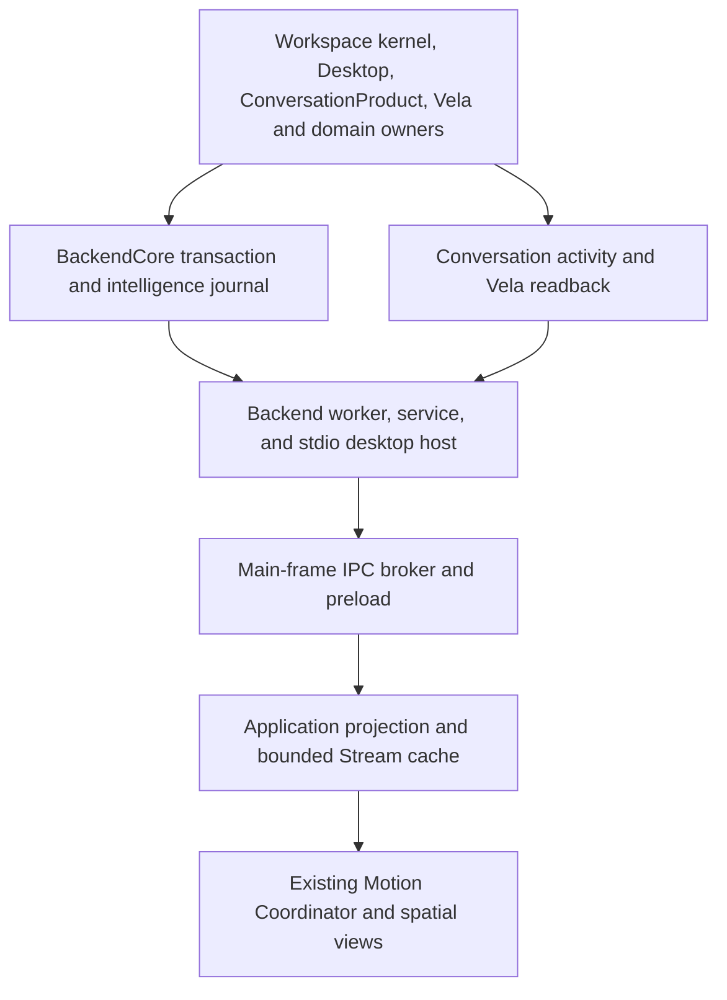

# A2.3 renderer and application coordination

Program A, Architecture Recovery. The starting revision is [merged A2.2](https://github.com/Kgray44/Aetherwake/commit/0287db1c56a87230f7592a730e6cdb42a88c123c). [Governance](https://github.com/Kgray44/Aetherwake/actions/runs/42880292301) and [Linux and Windows integration](https://github.com/Kgray44/Aetherwake/actions/runs/42880301280) passed independently on that revision. The merge tree matches qualified PR #27 head `9bb10da59276b9f3ef46dde2afac7af09b672810`.

One continuous spatial universe. No disconnected screen changes.

The [runtime inventory](A0-A1-RUNTIME-OWNERSHIP.md), [transaction guarantees](A2-1-TRANSACTION-COORDINATION.md), [routing guarantees](A2-2-ROUTING-AUTHORIZATION-COORDINATION.md), and [Spatial Intelligence contract](../architecture/UNIFIED-SPATIAL-INTELLIGENCE-RUNTIME-AND-NAVIGATION.md) govern this slice. It retains the application’s current renderer, domain storage, Motion Coordinator and canonical permission checks.

## Runtime and source ownership

| Projection | Authority and identity | Hydration, invalidation and recovery |
|---|---|---|
| Projects, workspaces and resources | Workspace kernel and Desktop. Stable resource, project, workspace and block IDs and source versions. | Connected Desktop responses carry a journal watermark and scope. The renderer serializes canonical reads with its command queue. Scope changes retire the old cache. Pending writes keep their original owner and version fences. |
| Intelligence events | Core owns journal rows, event IDs, global retention and source authorization. | Electron forwards validated bounded requests. Live notices prompt reconciliation. Scope-filtered rows still advance scan coverage. The renderer keeps the last 250 authorized events in memory. Disposal releases the listener. Reopening hydrates from Core. |
| Conversation text, drafts and execution | Graph and ConversationProduct own messages, revisions and drafts. Core owns execution ID, provider binding and terminal state. | A visible chat observes scoped activity. A complete preview can replace deltas through its cursor. An explicit empty or denied preview clears painted partial text. Canonical draft and selection conflicts retain their own errors. |
| Vela requests and receipts | VelaService and Core own request, plan, provider and effect receipts. | Event notices and an active-only read repair the manifestation. An obsolete scoped observation is discarded. A provider result and its native effect remain separate. |
| Navigation, gesture and motion | Desktop and the workspace engine persist canonical geometry. Constellation owns the real pointer hit and gesture identity. Motion Coordinator owns ephemeral poses and transitions. | View persistence uses the conversation revision fence. Obsolete scroll metadata is retired after a canonical append. The native harness checks the real pointer-owned key before moving and verifies the canonical result separately. |

## Event and state reconciliation

| Situation | Owner contract and renderer action |
|---|---|
| Startup and reopen | Subscribe before hydration. Read the connected Desktop snapshot and its cursor. Seed history at or below that cursor, then scan forward. A recent tail can contain newer rows, which it cannot acknowledge on behalf of the snapshot. |
| Normal page | `after` excludes earlier rows. `earliest` and `latest` bound the global journal. `scannedThrough` acknowledges the raw positions examined in this page. A page with zero visible events can still advance. |
| Duplicate or delayed live notice | A live notice can schedule a read. It cannot append a retained event or advance the cursor. The bounded cache deduplicates canonical event IDs. |
| Lost event | The next notice or foreground read scans from the last acknowledged position. A visible Stream also checks its scoped cursor periodically. A visible active conversation reads its own execution state. |
| Retention or changed scope | Reject the page, retire its generation and fetch a fresh authorized snapshot. A recovered retention gap is labeled. Missing event bodies remain unavailable. |
| Revocation during a read | Core checks current source visibility before IPC. A share revocation commits with a metadata-only event. The renderer rejects pre-invalidation snapshots and clears protected previews. Pending editor and command data stay with their existing owner. Provider-only invalidation clears stale execution projections without obscuring the workspace. |
| Backend loss | Stop rendering live preview and retire pending replay reads. The current worker-loss contract recovers when the application restarts. No automatic operation redispatch follows read repair. |

Core samples replay bounds and rows in one read transaction. The connected renderer IPC exposes scoped replay. Trusted legacy replay callers keep the original interface. The shared application read continues to use Core and existing product clients. No new durable store or animation scheduler is introduced.

## Vela lifecycle

| Canonical observation | Presentation |
|---|---|
| A request is planning, checking, or has a started effect receipt | Working presence reflects that specific observed phase. It refreshes while activity is observed. |
| Awaiting review | Review UI follows the canonical request and exact owner plan. |
| Scoped provider partial is authorized | The preview carries the observed request and provider identity. Canonical denial clears the preview even if the execution ID remains active. |
| Provider terminal | Conversation activity can retire busy from the observed terminal record after a missed notification. Verified effects and missions still use their separate receipts. |
| Cancellation requested | The UI can show the request while awaiting confirmation. It reports interruption only from a canonical terminal state. |
| Failure, unknown or disconnect | Failed and unknown states remain distinct. A disconnected view clears live text and reports the last observed state as unconfirmed. Restart may reconcile persisted receipts without repeating an effect. |

The form still waits for its specific submission promise to settle. Canonical completion while that response remains indefinitely hung is a separate unqualified case. A completely inactive, hidden renderer checks arbitrary missed metadata on return or on its next read trigger.

## Spatial and view evidence

The previous drag solver rejected 73 candidate points using conservative projected circles. A bounded CPU reconstruction of the captured scene found that the production mesh ray selected the moon at all 73 points at the reconstructed initial pose, while the final recorded pose was genuinely occluded by a project. The harness now uses projection bounds to generate candidates and the production picker to admit them. It rechecks the current frame, then verifies the actual native press-owned key before movement. The normal pointer and mutation path still owns the move and pin.

The stale-view receipt showed a correct selected resource and a failed Explore after `stale_view_conversation_revision`. ConversationProduct was correctly protecting the old version. The renderer used to retain that view-only failure in the flush queue. The coordinator now retires that specific capture without rebasing it. A disk-backed owner regression appends a canonical message during the save, checks that the stale view does not write, and checks that the next current capture persists. Other version, draft and access failures keep their existing semantics.

## A3 storage and CIE readiness

1. Inventory SQLite owners, retained cursor sizes, source revisions, journal growth, reopen costs and whole-snapshot allocation. Measure on independent fixtures and keep the operating-system reserve separate from SQLite limits.
2. Measure the current bounded history, lexical mission retrieval, selected-document fences and exact local retrieval. Record what each can recall, correct and delete with provenance.
3. Add held-out semantic evaluations for paraphrase, conflicts, correction, scope revocation and cross-provider continuity. Measure actual answer and authorization outcomes. Preserve direct, model-free exact retrieval.
4. Keep provider access, billing authority and disclosure with their canonical owners. Full semantic CIE, immersive Stream V2 and the volumetric Vela Presence remain Full Realization work.
