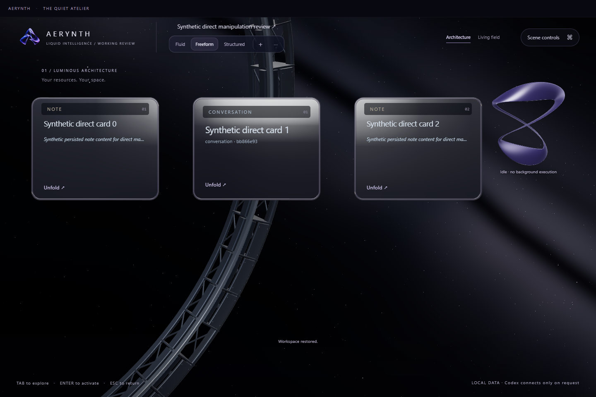

# Direct card interaction

The owner requested consistent card edges, effortless resizing, and removal of move controls and taskbar-style workspace setup.

Rectangular, folio and rounded cards now share an 18px contour in the single GPU/DOM outline contract. Focused readers join the same outline. Deliberate compact circles, lenses and pills retain their distinct silhouettes. Canonical shapes and geometry do not need a destructive migration.

The native application mounts `mountDirectManipulation` on existing articles. A noninteractive surface starts dragging after a four-pixel threshold. Text editors, selectable transcripts, links, inputs and buttons retain their ordinary behavior. Invisible edge and corner regions resize with native directional cursors. The existing `LayoutGesture`, preview policy and Motion Coordinator perform geometry; no resource, renderer or animation scheduler is duplicated. The product owner's latest correction explicitly preserves the original lifted, spring-following drag and target outline in all three modes; removing movement controls does not authorize removing those physical interactions.

The earlier host integration unconditionally called `motion.snap` for `.direct-manipulating`, bypassing spring following for move and resize samples. The owned module now offers optional `onGestureChange(state|null)` and `presentation()`: a frozen `{blockId,intent:'move'|'resize',phase:'active'|'committing'}` record, emitted only on lifecycle transitions. Move becomes active after4 CSS pixels; resize pickup is immediate. Release publishes committing until the one canonical command finishes; Escape, stale workspace/revision, no-op, loss of capture, hidden-document cancellation, disposal and completion clear it. Geometry remains solely in the existing preview request and canonical policy. Root owns removing unconditional move snapping, transient lift/z-order, the shared spring, outline painting and reduced-motion behavior. Resize may retain active-edge precision. No second gesture, constraint solver, store, toolbar or animation loop is introduced. The canonical16-unit Structured policy and grid-only mode entry remain unchanged; perceived grid density/fade belong to the visual/MC owners.

Source tests cover transition-only publication, final release, stale revision, movement threshold, Escape, no-op/disposal and all-mode resolved placement outlines without saved-state mutation. This seam is source evidence; the repaired Main/MC integration needs fresh native motion/visual checks in every mode. Historical immediate-snap receipts below do not qualify the restored feel.

Release records one revision-fenced canonical placement command. Escape, lost pointer capture, hidden surfaces and workspace/revision changes cancel previews. Keyboard focus on a card supports arrow movement and Shift+arrow resizing; Alt makes one-pixel adjustments. Resource editors retain DOM identity and do not receive redundant value assignments during reconciliation.

Legacy move arrows, grip buttons, per-card resize widgets, canvas pan buttons and the persistent bottom dock are removed from the integrated application. Fluid, Freeform and Structured appear in a compact section beside the workspace entry, with Add and an overflow action. Resource navigation, history, streams and connections remain available in contextual workspace actions. Per-card context actions offer focus, stacking, locking, removal and presentation; they contain no numeric move/resize setup. Blank-canvas navigation and other retained shortcuts remain host-owned.

`integration-direct.cjs` is an actual desktop test driver for the native host's `--integration-direct` dispatch. It uses explicit synthetic fixture commands, then native mouse input for surface dragging and all eight resize directions, cancellation, compact mode selection, editor identity/selection and fresh-process persistence. Captures require a focused window and a new GPU draw submission. This source checkpoint passes the application typecheck and 79 visual regression tests; the driver has passed syntax checking. The executed native journey and its bounded acceptance are recorded below.

The native direct journey now passes **7 checks**, plus **1 fresh-process restoration check**, with four captured images and zero renderer errors. Actual native input exercised surface dragging, every edge/corner resize direction, Escape cancellation and the compact mode controls. Editor identity/selection and exact persisted placement/content/viewport recovery passed. The visible Move Vela strip was removed after the first screenshot review; Vela uses its existing pointer behavior directly on her surface.

[Recorded acceptance](../visual-experience/cinematic-v3/evidence-direct-interaction/acceptance.json) retains the executed source/build hashes, synthetic fixture actions and image receipts. Two source files were subsequently normalized from CRLF to LF; original bytes and both digests remain in local evidence custody. Later additive service/bootstrap changes and combined application wiring require their own qualification. This is bounded direct-interaction evidence, not complete Block Library, performance or artistic acceptance.

The separate Fluid visibility fix is `8ca89ec`. Its older glass-host verification passed 10 native checks with four source-bound images; that evidence remains separate from the new gesture/corner evidence.
