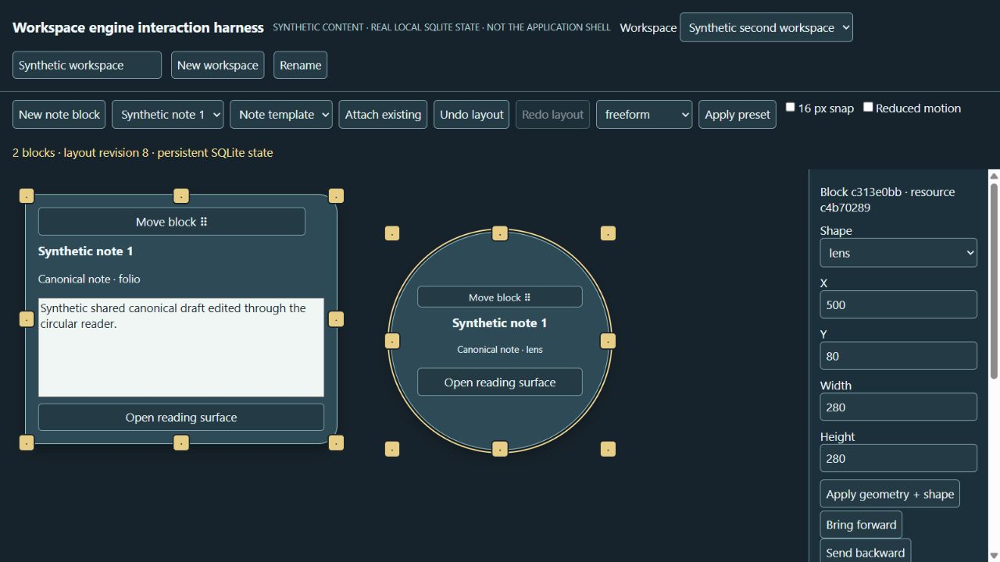

# Workspace engine verification

Date: 2026-11-01. Synthetic data only. Implementation branch: `codex/dynamic-workspaces`, based on integration candidate `b05b4dd`. Core handoff: `fcce254`. This report covers this worker's engine and harness; integration-lead evidence remains independently owned.

## Executed checks

- `npm test`: 21 passing engine tests. Real disk-backed 0/1/3/10/25/50-block layouts reopen identically. Multiple workspaces share resource identity while geometry/presentation stay independent. Tests cover lock/layer, shape and resize persistence, atomic geometry+shape, invalid/nonfinite/out-of-range input, duplicate IDs, stale revisions and two SQLite connections, rollback, detach/archive/delete policy, templates/presets, restart-persistent undo/redo/checkpoints, migration and failed migration, and interrupted child-process hot-journal recovery.
- `node --test ../workspace-kernel/tests/*.test.mts`: all 12 existing kernel tests pass. Kernel source and schema were not changed.
- Strict TypeScript check passed using the integration checkout's existing TypeScript and Node types, with `--noEmit --allowImportingTsExtensions --module nodenext --target es2023 --lib es2023,dom --strict --skipLibCheck`. Checked contracts, engine, geometry, interaction, benchmark, demo server and tests. The engine and fixture tests require only Node at runtime; type checking requires the host's TypeScript/@types/node toolchain.
- `git diff --check`: passed.

## Browser interaction evidence

The loopback harness uses the real engine and SQLite database; content is explicitly synthetic and no provider sessions run. Browser controls were operated through computer-use APIs, including actual pointer drag and keyboard input:

1. Opened an empty workspace (0 blocks), created a note block (1 block).
2. Edited its canonical draft, resized SE with ArrowRight (400→408 px width), then dragged the SE pointer handle (408×320→520×380). Draft text remained visible.
3. Alt+ArrowRight on the grip moved X from 32→40. Applied circle shape: height became 520 to match width, resource ID retained.
4. Opened the compact circle into a rectangular reading surface, edited the same note and closed it. Duplicated the placement, preserving one canonical note.
5. Created a second empty workspace and attached the existing note through a different template. The updated canonical text appeared; presentation was independent (folio 400×320 versus circle 520×520 in the first workspace).
6. Saved a checkpoint, detached the block and used Undo. The same block ID and canonical draft returned.
7. Added a second placement to that workspace and applied geometry+shape together (lens, X=500,Y=80,280×280). Its other placement stayed folio 400×320. Reload preserved both geometries, shapes, draft and workspace selection.
8. Tested an 800×600 viewport. Initial recovery left too little of an offscreen block reachable; `reachable()` was corrected to fit the entire block when it fits in the viewport. Rechecked at 800×600 and restored the default viewport. Saved coordinates remained 500,80; automatic recovery changes only the view. Blocks can overlap in the smaller recovery view, with keyboard/property controls still available. No physical monitor claim.
9. A plain grip click originally recorded a no-op save; corrected the binding to commit only changed gestures and verified the displayed revision stayed unchanged after a click. Automated binding tests cover no-op, Escape, pointercancel, capture release and selection restoration.

The screenshot is the utility harness, not the Cinematic renderer. This demonstrates browser interaction and persistence, not native application usability, full accessibility review, visual acceptance or owner approval.

## Exploratory performance observations

Predeclared benchmark: three independent disk-backed databases, each with 50 real blocks, 10 warm-up updates, 100 measured layout moves, then 100 projections. Full 100-operation history is retained. No outliers removed; percentiles use sorted samples and floor(n*p). No acceptance threshold or framework comparison is claimed. Run `npm run benchmark` to reproduce. All temporary benchmark databases are closed and removed by the benchmark.

Environment: Windows 10.0.26300, Node v24.18.0, AMD Ryzen AI 7 350 w/ Radeon 860M. Other application/agent workloads were concurrent and were not sampled or attributed. Measurements are synchronous service wall time from `node:perf_hooks`, not browser input latency, FPS, GPU/CPU attribution, native frame time or memory profiling.

| Trial | Move p50 / p95 / p99 (ms) | Projection p50 / p95 / p99 (ms) | DB bytes |
|---|---|---|---|
| 1 | 95.38 / 118.62 / 167.43 | 18.58 / 34.26 / 36.39 | 7,913,472 |
| 2 | 84.19 / 111.63 / 164.60 | 17.87 / 33.94 / 37.30 | 7,913,472 |
| 3 | 88.53 / 108.91 / 211.57 | 19.93 / 38.44 / 48.74 | 7,913,472 |

Full snapshot history currently rewrites a bounded JSON history per workspace and projections parse it to determine undo availability. This is adequate as a bounded functional candidate, with a visible scaling cost. Keep service execution in the existing backend worker, send one save per completed gesture, and keep pointer previews/Motion Coordinator local. Do not poll project() every frame. Row-based history storage/summary counters and batched projection queries are future performance work if measured integration latency requires them. The preview binder does not perform SQLite writes on pointermove.

## Scope and recovery limits

The reusable engine and contracts are implemented and fixture/browser tested. The integration lead owns the native renderer, service command wiring and migration of interim desktop presentation metadata. This worker did not edit those files or claim native acceptance.

Future work outside this worker's verified scope: OS monitor discovery, physical multi-monitor disconnect/DPI testing, native detached windows, arbitrary third-party shapes/providers, alignment guides, assistive-technology review, native motion/frame-time benchmarking and product-owner visual acceptance. Layout preset names are conveniences, not compulsory workspace modes. Templates are small explicit presentation recipes. Resource deletion is deliberately blocked without a host retention/approval policy, and retained layout recovery references also block canonical deletion. Resource/archive/draft changes themselves are not undone by layout undo.

History: last 100 layout operations per workspace; checkpoint limit: 64 per workspace; retry receipts: last 256 engine commands. A revision conflict retains persisted state; the caller retains the attempted command/draft and must present conflict recovery rather than retrying with a fresh revision silently. A direct legacy-kernel mutation can cause `HISTORY_DIVERGED`; it is preserved and requires a reviewed checkpoint/new operation instead of forced undo.

Local storage checks stayed above the separate 30 GiB reserves. Initial read: C:112,388,661,248 bytes, D:501,728,423,936 bytes. A 256 MiB C: write budget was checked before worktree and implementation/tests, then 128 MiB before further harness evidence; D: estimate was zero. Final small-write check: C:110,860,316,672 bytes, D:501,728,325,632 bytes, C:16 MiB additional budget allowed. Demo main DB is capped at 32 MiB (up to 32 MiB extra rollback journal); the guard is an instruction-based monitor, not an OS quota, and cannot constrain unrelated applications, cloud jobs, or writers that have not loaded the rule. Changes in global free bytes cannot be attributed to this worker alone.
